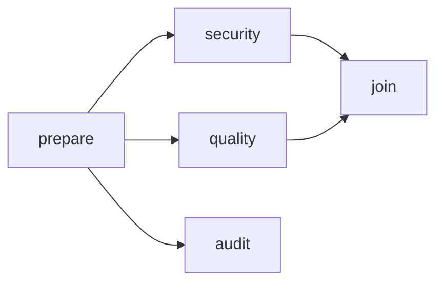

# Parallel review example

This example runs five Codex nodes over one review request. `prepare` creates a brief, `security` and `quality` review it independently, and `join` combines their reports. `audit` separately checks the prepared brief without using the other reports. The final aliases are returned as `review` and `audit`, in that order.



## Install and prepare

Build and pack Nodulus from its source checkout, then install that local archive in a consumer project. These steps validate a local package archive; they do not publish a registry release.

```sh
npm ci
npm run build
npm pack
```

From the consumer project, install the tarball produced by `npm pack` (the versioned filename is printed by that command), then copy the example configuration into a new project directory:

```sh
npm install /path/to/rogeriohsjr-nodulus-1.0.0.tgz
mkdir parallel-review-project
node -e "require('node:fs').cpSync('node_modules/@rogeriohsjr/nodulus/examples/parallel-review/.nodulus', 'parallel-review-project/.nodulus', { recursive: true })"
```

Edit `parallel-review-project/.nodulus/settings.json` to select a Codex executable and, optionally, a model available to your account. The supplied `fixture` profile is enabled, uses the Codex adapter and read-only sandbox, and has no optional capabilities. Its `timeoutMs` is 5,000 milliseconds; increase it if your provider needs more time. Make sure the Codex CLI is installed and authenticated.

The workflow declares `resources: []` for each node. These nodes consume saved inputs and do not need exclusive workspace access, so they can run concurrently when dependencies allow. The read-only provider sandbox further limits project edits; resource declarations coordinate Nodulus execution and are not a substitute for provider sandbox enforcement.

## Run with the installed CLI

Run from the consumer project where Nodulus is installed. Replace the sample request with the brief you want reviewed:

```sh
npx --no-install nodulus run --project ./parallel-review-project --workflow parallel-review --request "Review the release brief" --json
npx --no-install nodulus status <RUN_ID> --project ./parallel-review-project --json
npx --no-install nodulus inspect workflow parallel-review --project ./parallel-review-project --json
npx --no-install nodulus inspect run <RUN_ID> --project ./parallel-review-project --json
npx --no-install nodulus inspect export <RUN_ID> --project ./parallel-review-project --json
npx --no-install nodulus inspect replay <RUN_ID> --project ./parallel-review-project --json
```

Use the `runId` from the JSON envelope for the status and run-specific commands. Each node writes a nonempty `report.v1` artifact. When there are no findings, the instructions ask the reviewer to say so explicitly rather than return empty text.
